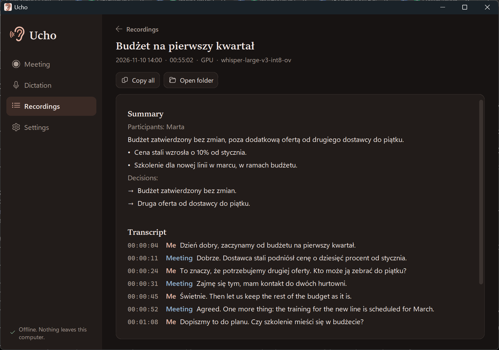

<picture>
  <source media="(prefers-color-scheme: dark)" srcset="design/assets/banner-en-dark.svg">
  
</picture>

<p align="center">
  <a href="https://ucho.app"><b>ucho.app</b></a> · <a href="../../releases">Download</a> · <a href="README.pl.md">Polski</a> · <a href="PRIVACY.md">Privacy</a> · <a href="LICENSE">Apache-2.0</a>
</p>

Records Teams, Zoom and Meet calls and your dictation, and turns them into text on your laptop with Whisper large-v3. No cloud, no bot in the meeting, no account. Built for Polish, fine with English and with meetings that mix both.

```
~/Ucho/recordings/2026-11-14_10-00_Budget-Q1/
├── microphone.flac     # you
├── meeting.flac        # everyone else
├── transcript.md       # text, speakers, timestamps
└── transcript.srt
```

| | |
|---|---|
| <kbd>Ctrl</kbd> <kbd>Alt</kbd> <kbd>R</kbd> | record a meeting, from any app |
| <kbd>Ctrl</kbd> <kbd>Shift</kbd> <kbd>Space</kbd> | dictate wherever your cursor is |
| **MCP** | Claude Code, Cursor or Codex read your transcripts |
| **1 h → 4–7 min** | to transcribe an hour of talk on Intel Arc graphics ([measured](docs/benchmarks.md)) |

<p align="center">
  
  
</p>

> **Tell participants you are recording.** Having no bot does not exempt you from the GDPR. A ready-made sentence is in [PRIVACY.md](PRIVACY.md).

## Install

1. Download `Ucho-Windows.zip` from [Releases](../../releases). Right-click it, choose **Extract All…**, change the destination to `C:\Users\<you>` and click **Extract**. Ucho lands in `C:\Users\<you>\Ucho\app`, outside OneDrive and next to your recordings.
2. Open that folder and double-click **`install.cmd`**. No admin rights needed. It downloads about 2 GB (Python, libraries, the speech model) and takes 10 to 20 minutes, longer on a slow connection. At the end it prints the command that connects Ucho to your AI agent.
3. Open **Ucho** from the Start menu. The first-run wizard picks a model for your hardware.

Windows 10 or 11, 16 GB RAM recommended, about 3 GB of disk (8 GB with summaries). No NVIDIA card needed. **Use headphones**, or the microphone records the other side a second time.

<details>
<summary>Installer options and troubleshooting</summary>

- From PowerShell instead of a double-click, in the app folder: `powershell -ExecutionPolicy Bypass -File .\install.ps1`
- `-WithSummary`: local summaries (Qwen model, about 5 GB). Off by default.
- `-WithParakeet`: an extra NVIDIA Parakeet engine, fast on the CPU alone. Weaker with English phrases inside Polish sentences. Choose it in Settings → Hardware.
- `-Force`: install inside a OneDrive folder without asking. Not recommended: models, settings and the log with your dictated text would sync to the cloud.
- Options also work with the double-click file: `install.cmd -WithSummary`.
- Every run is logged to `install.log` in the app folder. Ucho is not code-signed yet, so Windows may warn before running `install.cmd`.

</details>

## AI agent (MCP)

The installer prints this command with your real paths. `-s user` makes Ucho available in every project:

```powershell
claude mcp add -s user ucho -- "C:\Users\<you>\Ucho\app\.venv\Scripts\python.exe" "C:\Users\<you>\Ucho\app\mcp_server.py"
```

Then ask: *"What did we agree with the steel supplier last week?"* The server is read-only, runs over stdio and opens no ports. The agent sends the excerpts it reads to its own model; Ucho itself sends nothing.

<details>
<summary>Cursor, Claude Desktop and Codex</summary>

Cursor (`%USERPROFILE%\.cursor\mcp.json`) and Claude Desktop (Settings → Developer → Edit Config) take JSON, where every backslash is doubled:

```json
{
  "mcpServers": {
    "ucho": {
      "command": "C:\\Users\\<you>\\Ucho\\app\\.venv\\Scripts\\python.exe",
      "args": ["C:\\Users\\<you>\\Ucho\\app\\mcp_server.py"]
    }
  }
}
```

Codex (`%USERPROFILE%\.codex\config.toml`):

```toml
[mcp_servers.ucho]
command = 'C:\Users\<you>\Ucho\app\.venv\Scripts\python.exe'
args = ['C:\Users\<you>\Ucho\app\mcp_server.py']
```

Restart the client afterwards.

</details>

## Uninstall

Quit Ucho (tray icon → Quit) and double-click **`uninstall.cmd`** in the app folder. It removes the *Ucho* and *Ucho Dictate* shortcuts from the Desktop and the Start menu, the start-with-Windows entry, and after a question the `.venv`, the downloaded models, the settings and the logs. Your recordings in `C:\Users\<you>\Ucho\recordings` stay unless you confirm deleting them in a separate step, which lists them first and deletes only the recording folders Ucho created. If the recordings folder is your user folder, Documents, Desktop, Downloads, a OneDrive root or a drive root, it deletes nothing there. Then delete the app folder yourself, and remove Python 3.12 in Settings → Apps if nothing else uses it. Remove the agent link with `claude mcp remove -s user ucho`.

## More

- [How it works](docs/architecture.md): two tracks instead of diarization, silence trimming, language detection, OpenVINO
- [Benchmarks](docs/benchmarks.md) and [hardware selection](docs/hardware.md)
- [Privacy](PRIVACY.md), including how to check that nothing leaves your computer
- [Screenshots](docs/screens), [design system](design/README.md), [contributing](CONTRIBUTING.md)

Limits: Windows only; everyone on the far end shares one "Meeting" label; transcription starts when you stop recording; the app is not code-signed yet.

Apache-2.0 · [NOTICE](NOTICE) · [model and library licenses](THIRD_PARTY.md) · Fryderyk Pryjma
