<picture>
  <source media="(prefers-color-scheme: dark)" srcset="design/assets/banner-en-dark.svg">
  
</picture>

<p align="center">
  <a href="https://ucho.app"><b>ucho.app</b></a> · <a href="../../releases">Download</a> · <a href="README.pl.md">Polski</a> · <a href="PRIVACY.md">Privacy</a> · <a href="LICENSE">Apache-2.0</a>
</p>

Records Teams, Zoom and Meet calls and your dictation, and turns them into text on your laptop with Whisper large-v3. No cloud, no bot in the meeting, no account. Built for Polish, fine with English and with meetings that mix both.

```
~/Ucho/recordings/2026-11-14_10-00_Budget-Q1/
├── microphone.flac     # you
├── meeting.flac        # everyone else
├── transcript.md       # text, speakers, timestamps
└── transcript.srt
```

| | |
|---|---|
| <kbd>Ctrl</kbd> <kbd>Alt</kbd> <kbd>R</kbd> | record a meeting, from any app |
| <kbd>Ctrl</kbd> <kbd>Shift</kbd> <kbd>Space</kbd> | dictate wherever your cursor is |
| **MCP** | Claude Code, Cursor or Codex read your transcripts |
| **1 h → 4 min** | to transcribe an hour of talk on Intel Arc graphics |

<p align="center">
  
  
</p>

> **Tell participants you are recording.** Having no bot does not exempt you from the GDPR. A ready-made sentence is in [PRIVACY.md](PRIVACY.md).

## Install

1. Download `Ucho-Windows.zip` from [Releases](../../releases) and unzip it **outside OneDrive** (e.g. `C:\Users\<you>\Ucho\app`).
2. Run the installer, no admin rights needed:
   ```powershell
   powershell -ExecutionPolicy Bypass -File .\install.ps1
   ```
3. Open **Ucho** from the Start menu. The first-run wizard picks a model for your hardware.

Windows 10 or 11, 16 GB RAM recommended, about 3 GB of disk. No NVIDIA card needed. **Use headphones**, or the microphone records the other side a second time.

<details>
<summary>Installer options and upgrading from v0.1</summary>

- `-WithSummary`: local summaries (Qwen model, about 5 GB). Off by default.
- `-WithParakeet`: an extra NVIDIA Parakeet engine, fast on the CPU alone. Weaker with English phrases inside Polish sentences. Choose it in Settings → Hardware.
- Upgrading from v0.1: unzip over the old folder and run `install.ps1` again. Settings and old recordings are carried over. Close the old *Ucho Dyktuj* window first, it holds Ctrl+Shift+Space.

</details>

## AI agent (MCP)

```powershell
claude mcp add ucho -- "C:\Users\<you>\Ucho\app\.venv\Scripts\python.exe" "C:\Users\<you>\Ucho\app\mcp_server.py"
```

Then ask: *"What did we agree with the steel supplier last week?"* The server is read-only, runs over stdio and opens no ports. In Claude Desktop and Cursor, add a stdio server with the same command. The agent sends the excerpts it reads to its own model; Ucho itself sends nothing.

## More

- [How it works](docs/architecture.md): two tracks instead of diarization, silence trimming, language detection, OpenVINO
- [Benchmarks](docs/benchmarks.md) and [hardware selection](docs/hardware.md)
- [Privacy](PRIVACY.md), including how to check that nothing leaves your computer
- [Screenshots](docs/screens), [design system](design/README.md), [contributing](CONTRIBUTING.md)

Limits: Windows only; everyone on the far end shares one "Meeting" label; transcription starts when you stop recording; the app is not code-signed yet.

Apache-2.0 · [NOTICE](NOTICE) · [model and library licenses](THIRD_PARTY.md) · Fryderyk Pryjma
