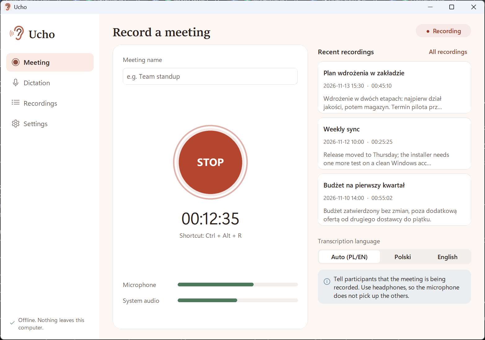

<picture>
  <source media="(prefers-color-scheme: dark)" srcset="design/assets/banner-en-dark.svg">
  
</picture>

<p align="center">
  <a href="https://ucho.app"><b>ucho.app</b></a> · <a href="../../releases">Download</a> · <a href="README.pl.md">Polski</a> · <a href="PRIVACY.md">Privacy</a> · <a href="LICENSE">Apache-2.0</a>
</p>

Records Teams, Zoom and Meet calls and your dictation, and turns them into text on your laptop with Whisper large-v3. No cloud, no bot in the meeting, no account. Built for Polish, fine with English and with meetings that mix both.

```
~/Ucho/recordings/2026-11-14_10-00_Budget-Q1/
├── microphone.flac     # you
├── meeting.flac        # everyone else
├── transcript.md       # text, speakers, timestamps
└── transcript.srt
```

| | |
|---|---|
| <kbd>Ctrl</kbd> <kbd>Alt</kbd> <kbd>R</kbd> | record a meeting, from any app |
| <kbd>Ctrl</kbd> <kbd>Shift</kbd> <kbd>Space</kbd> | dictate wherever your cursor is; recognized while you speak, pasted about a second after you stop |
| **Live** | the meeting is transcribed while you record, so the transcript is ready seconds after the stop (on a GPU or NPU) |
| **Speakers** | "Me" and "Meeting" from two tracks; optional experimental speaker detection inside a track ("Speaker 1", "Speaker 2"…) and naming speakers by clicking them on the transcript |
| **Titles & summaries** | optional: one local language model (chosen in the first-start wizard or in Settings → Language model) gives unnamed meetings short titles and can summarize them; built-in Qwen models or your own OpenVINO / `.gguf` model |
| **MCP** | Claude Code, Cursor or Codex read your transcripts |
| **1 h → 4–7 min** | to transcribe an hour of talk after the stop on Intel Arc graphics ([measured](docs/benchmarks.md)) |

<p align="center">
  
  
</p>

> **Tell participants you are recording.** Having no bot does not exempt you from the GDPR. A ready-made sentence is in [PRIVACY.md](PRIVACY.md).

## Install

1. Download **`Ucho-Setup.exe`** from [Releases](../../releases/latest/download/Ucho-Setup.exe) and run it. No admin rights needed. Ucho is not code-signed yet, so Windows may show "Windows protected your PC": click **More info**, then **Run anyway**. Setup installs to `C:\Users\<you>\Ucho\app`, outside OneDrive and next to your recordings.
2. Setup then opens a console window that downloads about 2 GB (Python, libraries, the speech model). It takes 10 to 20 minutes, longer on a slow connection. At the end it prints the command that connects Ucho to your AI agent; press Enter to close it.
3. Open **Ucho** from the Start menu (or tick *Start Ucho* on the last page of Setup). The first-run wizard picks a model for your hardware.

If your company blocks `.exe` files, or Smart App Control blocks Setup, use the zip instead: download `Ucho-Windows.zip`, right-click it, **Extract All…** to `C:\Users\<you>` (Ucho lands in `C:\Users\<you>\Ucho\app`) and double-click **`install.cmd`** in that folder. Running Setup again, or a newer Setup, updates Ucho and keeps settings, models and recordings.

Windows 10 or 11, 16 GB RAM recommended, about 3 GB of disk (8 GB with summaries). No NVIDIA card needed. **Use headphones**, or the microphone records the other side a second time.

<details>
<summary>Installer options and troubleshooting</summary>

- From PowerShell instead of a double-click, in the app folder: `powershell -ExecutionPolicy Bypass -File .\install.ps1`
- `-WithSummary`: pre-downloads the default language model (`OpenVINO/Qwen3-8B-int4-ov`, ~5.0 GB) and turns on summaries. Off by default.
- **Language model (meeting names and summaries)**: one local language model, chosen in the optional step of the first-start wizard or in Settings → Language model, serves both automatic meeting titles and summaries. Built-in models (`OpenVINO/Qwen3-8B-int4-ov` ~5.0 GB, `OpenVINO/Qwen3-4B-int4-ov` ~2.3 GB, `OpenVINO/Qwen2.5-1.5B-Instruct-int4-ov` ~0.95 GB) are downloaded on demand. You can also point Ucho at your own model ("My own model"): an OpenVINO IR folder exported with `optimum-cli` (`openvino_model.xml`/`.bin` + `openvino_tokenizer.xml` + `openvino_detokenizer.xml`) or a single `.gguf` file (`Q4_0` and `Q8_0` tested, `Q4_1` and `F16`/`F32` accepted; `Q4_K_M` and other K-quants do not load in OpenVINO GenAI 2026.4.1 and are rejected). Your model is never copied or uploaded; quality of Polish titles and summaries is not guaranteed for custom models. Settings from v0.4 keep working (the choice is derived from the models already downloaded).
- `-WithParakeet`: an extra NVIDIA Parakeet engine, fast on the CPU alone. Weaker with English phrases inside Polish sentences. Choose it in Settings → Hardware.
- `-WithSpeakers`: the optional `sherpa-onnx` package for speaker detection inside a track (Settings → Transcription → Speakers; two small models, ~33 MB, downloaded when you turn it on).
- `-Force`: install inside a OneDrive folder without asking. Not recommended: models, settings and the log with your dictated text would sync to the cloud.
- Options also work with the double-click file: `install.cmd -WithSummary`.
- Every run is logged to `install.log` in the app folder. Ucho is not code-signed yet, so Windows may warn before running `Ucho-Setup.exe` or `install.cmd`.
- Silent install for IT: `Ucho-Setup.exe /VERYSILENT` (no questions; Setup waits for `install.ps1` and logs to `install.log`).
- **Something went wrong?** The error dialog, or Settings → About → *Save diagnostics package*, saves a ZIP to Downloads (log with your dictated text and meeting titles removed, versions, hardware, settings without personal paths) and opens an e-mail draft; you attach the file and send it yourself. Details in [PRIVACY.md](PRIVACY.md#diagnostics-package).

</details>

## AI agent (MCP)

The installer prints this command with your real paths. `-s user` makes Ucho available in every project:

```powershell
claude mcp add -s user ucho -- "C:\Users\<you>\Ucho\app\.venv\Scripts\python.exe" "C:\Users\<you>\Ucho\app\mcp_server.py"
```

Then ask: *"What did we agree with the steel supplier last week?"* The server is read-only, runs over stdio and opens no ports. The agent sends the excerpts it reads to its own model; Ucho itself sends nothing.

<details>
<summary>Cursor, Claude Desktop and Codex</summary>

Cursor (`%USERPROFILE%\.cursor\mcp.json`) and Claude Desktop (Settings → Developer → Edit Config) take JSON, where every backslash is doubled:

```json
{
  "mcpServers": {
    "ucho": {
      "command": "C:\\Users\\<you>\\Ucho\\app\\.venv\\Scripts\\python.exe",
      "args": ["C:\\Users\\<you>\\Ucho\\app\\mcp_server.py"]
    }
  }
}
```

Codex (`%USERPROFILE%\.codex\config.toml`):

```toml
[mcp_servers.ucho]
command = 'C:\Users\<you>\Ucho\app\.venv\Scripts\python.exe'
args = ['C:\Users\<you>\Ucho\app\mcp_server.py']
```

Restart the client afterwards.

</details>

## Uninstall

Quit Ucho (tray icon → Quit). Installed with Setup: Settings → Apps → **Ucho** → Uninstall. Installed from the zip: double-click **`uninstall.cmd`** in the app folder. Both run the same uninstaller, which removes the *Ucho* and *Ucho Dictate* shortcuts from the Desktop and the Start menu, the start-with-Windows entry, and after a question the `.venv`, the downloaded models, the settings and the logs. Your recordings in `C:\Users\<you>\Ucho\recordings` stay unless you confirm deleting them in a separate step, which lists them first and deletes only the recording folders Ucho created. If the recordings folder is your user folder, Documents, Desktop, Downloads, a OneDrive root or a drive root, it deletes nothing there. The Setup uninstaller then removes the program files; after the zip install delete the app folder yourself. Remove Python 3.12 in Settings → Apps if nothing else uses it. Remove the agent link with `claude mcp remove -s user ucho`.

## More

- [How it works](docs/architecture.md): two tracks, optional speaker detection, live transcription, silence trimming, language detection, OpenVINO
- [Benchmarks](docs/benchmarks.md) and [hardware selection](docs/hardware.md)
- [Privacy](PRIVACY.md), including how to check that nothing leaves your computer
- [Screenshots](docs/screens), [design system](design/README.md), [contributing](CONTRIBUTING.md)

Limits: Windows only (macOS: [#22](../../issues/22)); only Intel graphics speed up transcription, so with NVIDIA or AMD graphics it runs on the CPU ([#21](../../issues/21)), where live meeting transcription is off by default; speaker detection inside a track is experimental and off by default; the app is not code-signed yet ([#18](../../issues/18)).

Apache-2.0 · [NOTICE](NOTICE) · [model and library licenses](THIRD_PARTY.md) · Fryderyk Pryjma
