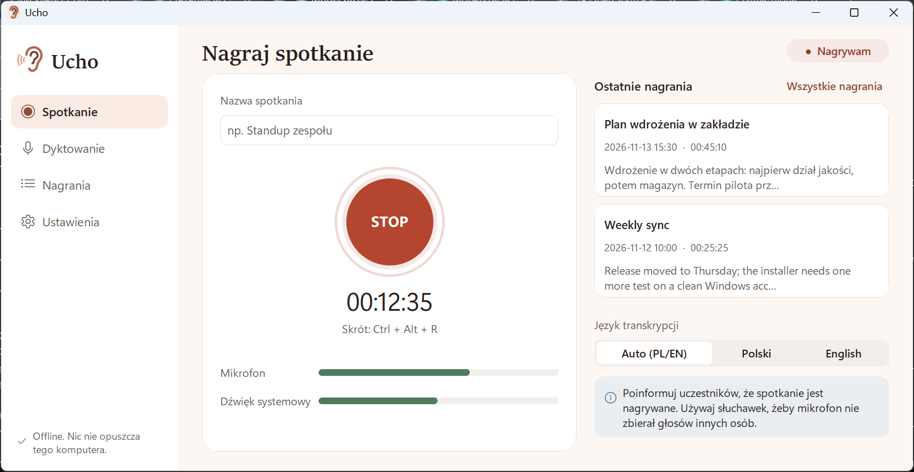

<picture>
  <source media="(prefers-color-scheme: dark)" srcset="design/assets/banner-pl-dark.svg">
  
</picture>

<p align="center">
  <a href="https://ucho.app"><b>ucho.app</b></a> · <a href="../../releases">Pobierz</a> · <a href="README.md">English</a> · <a href="PRIVACY.md">Prywatność</a> · <a href="LICENSE">Apache-2.0</a>
</p>

Nagrywa spotkania w Teams, Zoomie czy Meet oraz dyktowanie i zamienia je w tekst na Twoim laptopie, modelem Whisper large-v3. Bez chmury, bez bota na spotkaniu, bez konta.

```
~/Ucho/recordings/2026-11-14_10-00_Budzet-Q1/
├── microphone.flac     # Ty
├── meeting.flac        # reszta rozmowy
├── transcript.md       # tekst, mówcy, znaczniki czasu
└── transcript.srt
```

| | |
|---|---|
| <kbd>Ctrl</kbd> <kbd>Alt</kbd> <kbd>R</kbd> | nagrywaj spotkanie, z dowolnego programu |
| <kbd>Ctrl</kbd> <kbd>Shift</kbd> <kbd>Spacja</kbd> | dyktuj tam, gdzie stoi kursor |
| **Mówcy** | „Ja” i „Spotkanie” z dwóch ścieżek; opcjonalne eksperymentalne rozpoznawanie mówców wewnątrz ścieżki („Mówca 1”, „Mówca 2”…) i nazywanie ich kliknięciem na transkrypcie |
| **MCP** | Claude Code, Cursor czy Codex czytają Twoje transkrypty |
| **1 h → 4–7 min** | transkrypcja godziny rozmowy na grafice Intel Arc ([pomiary](docs/benchmarks.md)) |

<p align="center">
  
  
</p>

> **Poinformuj uczestników, że nagrywasz.** Brak bota nie zwalnia z RODO. Gotowa formułka jest w [PRIVACY.md](PRIVACY.md).

## Instalacja

1. Pobierz **`Ucho-Setup.exe`** z [Releases](../../releases/latest/download/Ucho-Setup.exe) i uruchom go. Uprawnienia administratora nie są potrzebne. Ucho nie ma jeszcze podpisu cyfrowego, więc Windows może pokazać komunikat „System Windows ochronił ten komputer”: kliknij **Więcej informacji**, a potem **Uruchom mimo to**. Instalator umieści Ucho w `C:\Users\<Ty>\Ucho\app`, poza OneDrive, obok Twoich nagrań.
2. Potem otworzy okno konsoli, które pobiera ok. 2 GB (Python, biblioteki, model mowy). Trwa to od 10 do 20 minut, a przy wolnym łączu dłużej. Na koniec okno wypisze polecenie, które podłącza Ucho do Twojego agenta AI; zamkniesz je Enterem.
3. Otwórz **Ucho** z Menu Start (albo zaznacz *Uruchom Ucho* na ostatniej stronie instalatora). Kreator dobierze model do Twojego sprzętu.

Jeśli firma blokuje pliki `.exe` albo instalator zablokuje Smart App Control, użyj wersji zip: pobierz `Ucho-Windows.zip`, kliknij prawym przyciskiem, **Wyodrębnij wszystkie…** do `C:\Users\<Ty>` (Ucho trafi do `C:\Users\<Ty>\Ucho\app`) i kliknij dwukrotnie **`install.cmd`** w tym folderze. Ponowne uruchomienie instalatora albo nowszej wersji aktualizuje Ucho, a ustawienia, modele i nagrania zostają.

Windows 10 lub 11, zalecane 16 GB RAM, ok. 3 GB na dysku (8 GB z podsumowaniami). Karta NVIDIA nie jest potrzebna. **Używaj słuchawek**, bo inaczej mikrofon nagra rozmówców drugi raz.

<details>
<summary>Opcje instalatora i gdy coś nie działa</summary>

- Z PowerShella zamiast dwukliku, w folderze programu: `powershell -ExecutionPolicy Bypass -File .\install.ps1`
- `-WithSummary`: lokalne podsumowania (model Qwen, ok. 5 GB). Domyślnie wyłączone.
- `-WithParakeet`: dodatkowy silnik NVIDIA Parakeet, szybki na samym procesorze. Słabiej radzi sobie z angielskimi wtrąceniami. Wybierasz go w Ustawieniach → Sprzęt.
- `-WithSpeakers`: opcjonalny pakiet `sherpa-onnx` do rozpoznawania mówców wewnątrz ścieżki (Ustawienia → Transkrypcja → Mówcy; dwa małe modele, ok. 33 MB, pobierane przy włączeniu opcji).
- `-Force`: instalacja w folderze OneDrive bez pytania. Odradzamy: modele, ustawienia i log z podyktowanym tekstem trafiłyby do chmury.
- Opcje działają też z plikiem do dwukliku: `install.cmd -WithSummary`.
- Przebieg każdej instalacji trafia do `install.log` w folderze programu. Ucho nie ma jeszcze podpisu cyfrowego, więc Windows może ostrzec przed uruchomieniem `Ucho-Setup.exe` albo `install.cmd`.
- Cicha instalacja dla działu IT: `Ucho-Setup.exe /VERYSILENT` (bez pytań; instalator czeka na `install.ps1`, przebieg trafia do `install.log`).

</details>

## Agent AI (MCP)

Instalator wypisuje to polecenie z prawdziwymi ścieżkami. Dzięki `-s user` Ucho działa w każdym projekcie:

```powershell
claude mcp add -s user ucho -- "C:\Users\<Ty>\Ucho\app\.venv\Scripts\python.exe" "C:\Users\<Ty>\Ucho\app\mcp_server.py"
```

Potem zapytaj: *„Co ustaliliśmy w zeszłym tygodniu z dostawcą stali?”* Serwer działa tylko do odczytu, przez stdio, bez portów. Agent wysyła przeczytane fragmenty do swojego modelu; Ucho samo niczego nie wysyła.

<details>
<summary>Cursor, Claude Desktop i Codex</summary>

Cursor (`%USERPROFILE%\.cursor\mcp.json`) i Claude Desktop (Ustawienia → Developer → Edit Config) przyjmują JSON, w którym każdy ukośnik wsteczny trzeba podwoić:

```json
{
  "mcpServers": {
    "ucho": {
      "command": "C:\\Users\\<Ty>\\Ucho\\app\\.venv\\Scripts\\python.exe",
      "args": ["C:\\Users\\<Ty>\\Ucho\\app\\mcp_server.py"]
    }
  }
}
```

Codex (`%USERPROFILE%\.codex\config.toml`):

```toml
[mcp_servers.ucho]
command = 'C:\Users\<Ty>\Ucho\app\.venv\Scripts\python.exe'
args = ['C:\Users\<Ty>\Ucho\app\mcp_server.py']
```

Potem uruchom klienta ponownie.

</details>

## Odinstalowanie

Zamknij Ucho (ikona w zasobniku → Zakończ). Po instalacji instalatorem: Ustawienia → Aplikacje → **Ucho** → Odinstaluj. Po instalacji z zip: kliknij dwukrotnie **`uninstall.cmd`** w folderze programu. W obu przypadkach działa ten sam deinstalator, który usunie skróty *Ucho* i *Ucho Dictate* z Pulpitu i Menu Start, wpis autostartu, a po pytaniu także `.venv`, pobrane modele, ustawienia i logi. Nagrania w `C:\Users\<Ty>\Ucho\recordings` zostają, chyba że osobno potwierdzisz ich usunięcie: deinstalator najpierw je wypisze i usunie tylko foldery nagrań utworzone przez Ucho. Jeśli folder nagrań to Twój folder użytkownika, Dokumenty, Pulpit, Pobrane, główny folder OneDrive albo główny katalog dysku, niczego z niego nie usunie. Deinstalator z „Aplikacji” usunie potem pliki programu; po instalacji z zip usuń folder programu sam. Pythona 3.12 odinstaluj w Ustawieniach → Aplikacje, jeśli nic innego go nie używa. Połączenie z agentem usuniesz poleceniem `claude mcp remove -s user ucho`.

## Więcej

- [Jak to działa](docs/architecture.md): dwie ścieżki zamiast diaryzacji, wycinanie ciszy, wykrywanie języka, OpenVINO
- [Pomiary](docs/benchmarks.md) i [dobór sprzętu](docs/hardware.md)
- [Prywatność](PRIVACY.md) i jak sprawdzić, że nic nie wychodzi z komputera
- [Zrzuty ekranu](docs/screens), [design system](design/README.md), [jak pomóc](CONTRIBUTING.md)

Ograniczenia: tylko Windows; wszyscy rozmówcy zdalni mają jedną etykietę „Spotkanie”; transkrypcja rusza po zatrzymaniu nagrania; aplikacja nie jest jeszcze podpisana cyfrowo.

Apache-2.0 · [NOTICE](NOTICE) · [licencje modeli i bibliotek](THIRD_PARTY.md) · Fryderyk Pryjma
