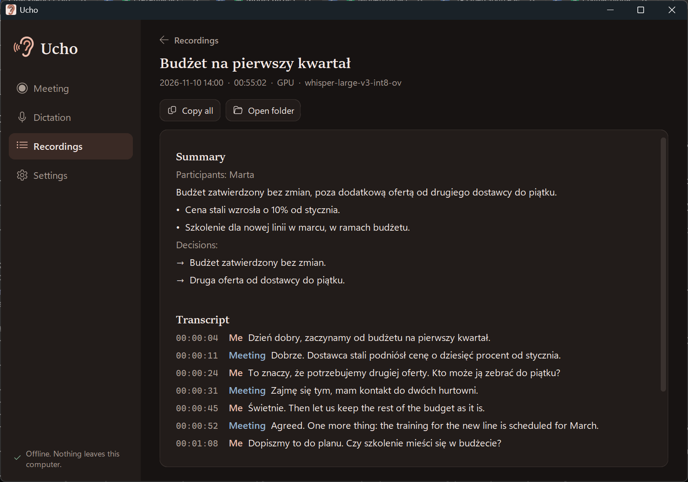

<picture>
  <source media="(prefers-color-scheme: dark)" srcset="design/assets/banner-pl-dark.svg">
  
</picture>

<p align="center">
  <a href="https://ucho.app"><b>ucho.app</b></a> · <a href="../../releases">Pobierz</a> · <a href="README.md">English</a> · <a href="PRIVACY.md">Prywatność</a> · <a href="LICENSE">Apache-2.0</a>
</p>

Nagrywa spotkania w Teams, Zoomie czy Meet oraz dyktowanie i zamienia je w tekst na Twoim laptopie, modelem Whisper large-v3. Bez chmury, bez bota na spotkaniu, bez konta.

```
~/Ucho/recordings/2026-11-14_10-00_Budzet-Q1/
├── microphone.flac     # Ty
├── meeting.flac        # reszta rozmowy
├── transcript.md       # tekst, mówcy, znaczniki czasu
└── transcript.srt
```

| | |
|---|---|
| <kbd>Ctrl</kbd> <kbd>Alt</kbd> <kbd>R</kbd> | nagrywaj spotkanie, z dowolnego programu |
| <kbd>Ctrl</kbd> <kbd>Shift</kbd> <kbd>Spacja</kbd> | dyktuj tam, gdzie stoi kursor |
| **MCP** | Claude Code, Cursor czy Codex czytają Twoje transkrypty |
| **1 h → 4 min** | transkrypcja godziny rozmowy na grafice Intel Arc |

<p align="center">
  
  
</p>

> **Poinformuj uczestników, że nagrywasz.** Brak bota nie zwalnia z RODO. Gotowa formułka jest w [PRIVACY.md](PRIVACY.md).

## Instalacja

1. Pobierz `Ucho-Windows.zip` z [Releases](../../releases) i rozpakuj **poza OneDrive** (np. `C:\Users\<Ty>\Ucho\app`).
2. Uruchom instalator, bez uprawnień administratora:
   ```powershell
   powershell -ExecutionPolicy Bypass -File .\install.ps1
   ```
3. Otwórz **Ucho** z Menu Start. Kreator dobierze model do Twojego sprzętu.

Windows 10 lub 11, zalecane 16 GB RAM, ok. 3 GB na dysku. Karta NVIDIA nie jest potrzebna. **Używaj słuchawek**, bo inaczej mikrofon nagra rozmówców drugi raz.

<details>
<summary>Opcje instalatora i aktualizacja z v0.1</summary>

- `-WithSummary`: lokalne podsumowania (model Qwen, ok. 5 GB). Domyślnie wyłączone.
- `-WithParakeet`: dodatkowy silnik NVIDIA Parakeet, szybki na samym procesorze. Słabiej radzi sobie z angielskimi wtrąceniami. Wybierasz go w Ustawieniach → Sprzęt.
- Aktualizacja z v0.1: rozpakuj paczkę na stary folder i uruchom `install.ps1` jeszcze raz. Ustawienia i stare nagrania zostaną przeniesione. Najpierw zamknij stare okno *Ucho Dyktuj*, bo trzyma skrót Ctrl+Shift+Spacja.

</details>

## Agent AI (MCP)

```powershell
claude mcp add ucho -- "C:\Users\<Ty>\Ucho\app\.venv\Scripts\python.exe" "C:\Users\<Ty>\Ucho\app\mcp_server.py"
```

Potem zapytaj: *„Co ustaliliśmy w zeszłym tygodniu z dostawcą stali?”* Serwer działa tylko do odczytu, przez stdio, bez portów. W Claude Desktop i Cursorze dodaj serwer stdio z tym samym poleceniem. Agent wysyła przeczytane fragmenty do swojego modelu; Ucho samo niczego nie wysyła.

## Więcej

- [Jak to działa](docs/architecture.md): dwie ścieżki zamiast diaryzacji, wycinanie ciszy, wykrywanie języka, OpenVINO
- [Pomiary](docs/benchmarks.md) i [dobór sprzętu](docs/hardware.md)
- [Prywatność](PRIVACY.md) i jak sprawdzić, że nic nie wychodzi z komputera
- [Zrzuty ekranu](docs/screens), [design system](design/README.md), [jak pomóc](CONTRIBUTING.md)

Ograniczenia: tylko Windows; wszyscy rozmówcy zdalni mają jedną etykietę „Spotkanie”; transkrypcja rusza po zatrzymaniu nagrania; aplikacja nie jest jeszcze podpisana cyfrowo.

Apache-2.0 · [NOTICE](NOTICE) · [licencje modeli i bibliotek](THIRD_PARTY.md) · Fryderyk Pryjma
